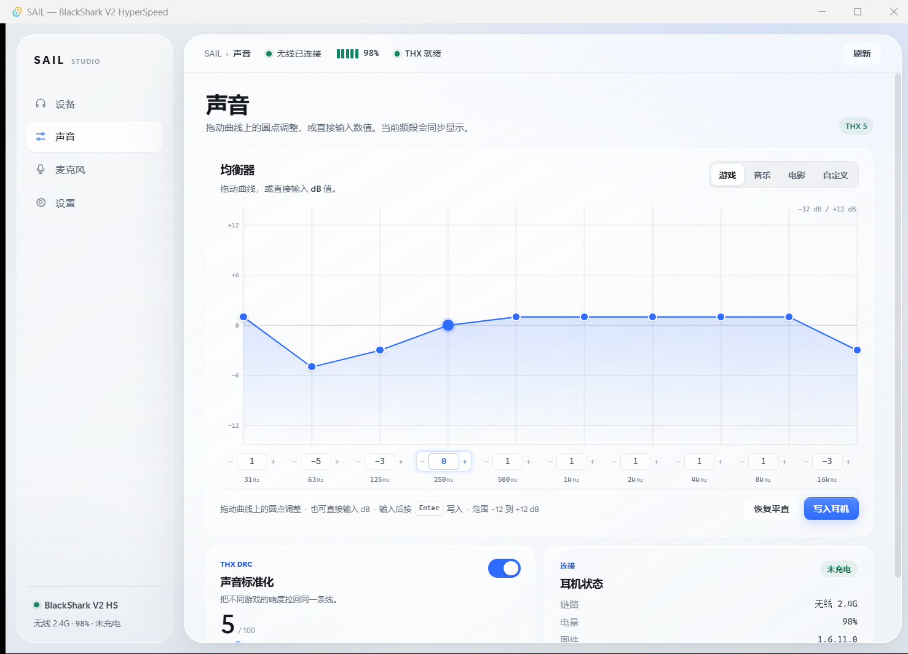
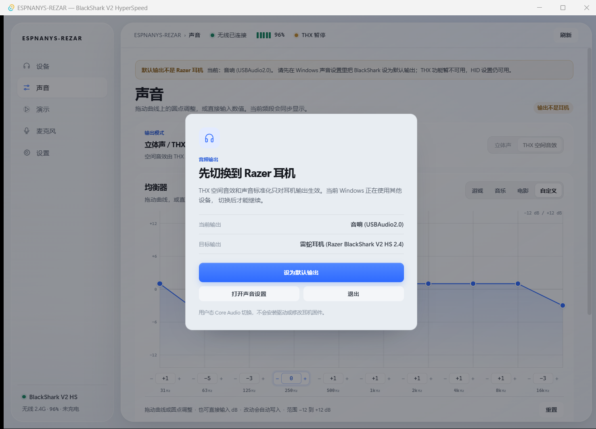
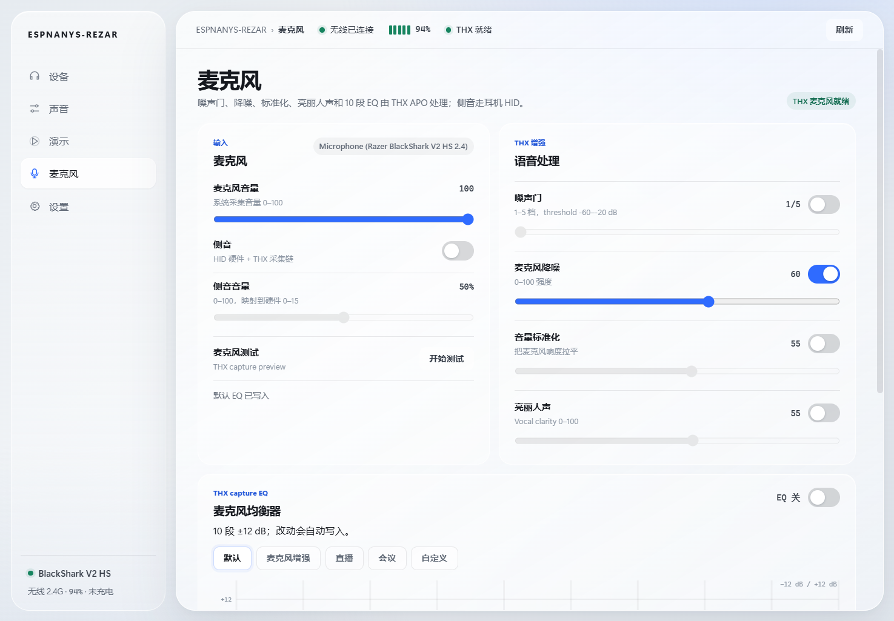
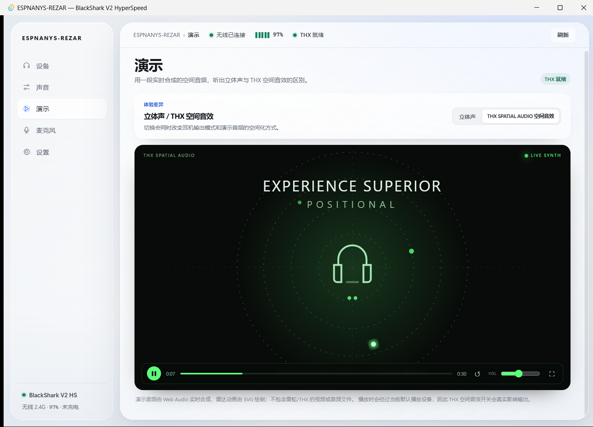

# ESPNANYS-REZAR — 雷蛇耳机驱动替代：Razer BlackShark V2 HyperSpeed 控制台

> 一个不依赖雷云 4 的**雷蛇耳机驱动替代方案**：自己实现 HID 控制，可选复用已安装的 THX APO。
> An open-source **Razer headset driver alternative** for BlackShark V2 HyperSpeed: native HID, Tauri UI, optional installed THX APO.

> 显示名：**ESPNANYS-REZAR**；作者：**SAIL**。代码模块、二进制和安装目录仍沿用 `sail_*` / `SAIL` 前缀，以兼容已有命令、脚本和升级路径。
> Display name: **ESPNANYS-REZAR**. Author: **SAIL**. The internal `sail_*` / `SAIL` module and install-path prefixes are intentionally kept for compatibility.

**搜索关键词 / Search terms:** 雷蛇耳机驱动 · 雷蛇耳机驱动替代 · 禁用雷蛇耳机驱动更新 · 禁用雷云4更新 · 禁用雷云 4 更新 · 雷云4自动更新怎么关闭 · Razer BlackShark V2 HyperSpeed driver · disable Razer Synapse 4 updates

[中文](#为什么会有-espnanys-rezar) · [English](#english)

## 为什么会有 ESPNANYS-REZAR

我立项这个项目，不是因为想再做一个“游戏外设面板”，而是因为**雷云 4 的后台自动更新把耳机驱动弄掉过**。

- 一次自动更新后，Windows 音频设备里的 BlackShark 直接消失，游戏里也没声音。
- 重新装驱动、回滚、重启，折腾很久才恢复；下一次更新又可能再来一次。
- 我只想稳定地用耳机：电量、侧音、均衡器、声音标准化，不想每次开局前先赌驱动还在不在。

所以 ESPNANYS-REZAR 的第一目标不是替代雷云的所有功能，而是：

1. **不依赖雷云也能控制耳机**（HID 自己实现）。
2. **不让雷云的后台更新再次把驱动弄掉**。
3. THX 声音处理继续复用用户机器上已经安装的 APO，不打包、不分发雷蛇/THX 的二进制。

> 这不是“破解雷云”，也不是驱动破解；它只做自己拥有设备上的互操作控制，并提供一个可逆的更新开关。

## 禁用雷蛇耳机驱动 / 雷云 4 自动更新

脚本就在仓库里，三个入口：

```text
scripts\razer-update-off.cmd      # 关闭：挡更新清单/安装包域名 + 禁用升级任务（需管理员）
scripts\razer-update-core.ps1     # 实际逻辑；可 -Status / -Disable / -Enable
scripts\razer-update-on.cmd       # 恢复：还原 hosts + 启用升级任务（需管理员）
```

以管理员身份打开 PowerShell：

```powershell
# 关闭雷云 4 / 雷蛇耳机驱动的后台自动更新
.\scripts\razer-update-off.cmd

# 只查看当前状态，不改任何东西
powershell -ExecutionPolicy Bypass -File .\scripts\razer-update-core.ps1 -Status

# 想恢复自动更新时
.\scripts\razer-update-on.cmd
```

它具体做两件事：

- 在 `hosts` 中把 Razer 更新控制面域名指向 `0.0.0.0`：
  - 更新清单：`manifest.razerapi.com`、`manifest3.razerapi.com`
  - 安装包：`app-assets.razer.com`、`cdn.razersynapse.com`、`manifest-assets.razersynapse.com`
  - 端点发现：`discovery.razerapi.com`、`discovery3.razerapi.com`
- 禁用计划任务 `Razer Upgrade Elevation Service`。

**不会**屏蔽 `apps.razer.com`（雷云远程 UI 和升级安装器页必须在，屏蔽会让设备面板白屏；更新清单仍能读到，但安装包下载已被 `app-assets.razer.com` 拦住，装不上），也不动 `VSSrv`、THX APO 或 HID；关闭后只是不再自动获得 Synapse/THX 更新。执行结束会打印 hosts、计划任务、Razer Elevation Service、VSSrv 的验证结果，不保存日志。

> 这是本机可逆开关，不是系统级“驱动锁”。Razer 以后如果更换 CDN/任务名，脚本可能失效；升级后先用 `-Status` 复查。屏蔽期间无法在线安装 Synapse 组件（驱动/模块），要装时先跑 `razer-update-on`，装完再关。企业设备或别人的电脑，先获得授权再运行。

## 它是什么

- 产品名：**ESPNANYS-REZAR**（内部模块仍为 `sail_core` / `sail_hid` / `sail_app` / `sail_thx_bridge` / `sail_ui`）
- 设备：**Razer BlackShark V2 HyperSpeed**（Windows 显示为 *Razer BlackShark V2 HS 2.4*，中文 *旋风黑鲨 V2 极速版*）
- 无线接收器：`VID 0x1532 / PID 0x0565`
- 有线 USB：`VID 0x1532 / PID 0x056E`
- 第二型号：**Razer BlackShark V2**（3.5mm）经 **Razer USB Sound Card**，`VID 0x1532 / PID 0x0529`；无电池/充电遥测，EQ/THX/麦克风走 THX，设备选择器可切换
- 测试环境：Windows 11，Rust 1.99（MSVC），Tauri 2 + Svelte 5，Razer Synapse 4.0.827
- 实测固件：**1.6.11.0**；序列号已脱敏

> THX 是可选运行时依赖：ESPNANYS-REZAR **不打包、不重分发** THX/Razer 的 DLL/APO。
> 只调用用户自己安装的 `ThxV3Native_v1.1.42.1.dll`。

## 30 秒上手

| 场景 | 命令 |
|---|---|
| 关闭雷蛇自动更新 | `scripts\razer-update-off.cmd`（管理员） |
| 恢复雷蛇自动更新 | `scripts\razer-update-on.cmd`（管理员） |
| 编译 HID/THX/CLI | `scripts\build.cmd -Stage` |
| 验证 THX 1–100 | `%LOCALAPPDATA%\SAIL\bin\sail_thx.exe verify` |
| 备份当前 THX APO | `scripts\backup-thx.cmd -Destination D:\Backup\THX` |
| 检查版本漂移 | `scripts\check-baseline.cmd` |
| 打包便携版 | `scripts\package-sail.cmd -Configuration Debug` |
| 目标机一键安装 | 双击 `dist\SAIL\install-sail.cmd` |
| 本机运行 UI | `scripts\run-ui.cmd` |

详细说明见下面的“构建 / 运行”“私有备份”“一键部署”“版本冻结”章节。

## English

### ESPNANYS-REZAR — a Razer headset driver alternative for BlackShark V2 HyperSpeed

ESPNANYS-REZAR is an independent, open-source **Razer headset driver alternative** for the Razer BlackShark V2 HyperSpeed (wireless `1532:0565`, wired `1532:056E`) and the BlackShark V2 through the Razer USB Sound Card (`1532:0529`). It was started after a **Razer Synapse 4 background auto-update knocked the headset driver out**: the device disappeared from Windows audio and games, and recovering it took far too long. ESPNANYS-REZAR exists so the headset can be controlled — and kept stable — without depending on Synapse.

- Native HID control on HyperSpeed: battery, charging, firmware, serial, sidetone, EQ, device flags.
- Second model: BlackShark V2 + USB Sound Card; THX EQ/mic/spatial/normalization, no fake battery or sidetone; explicit device selector.
- Optional THX APO reuse: sound normalization, stereo/spatial toggle, and THX processing via the copy already installed on your PC.
- Built-in spatial demo: an original SVG radar and Web Audio test sound; no Razer/THX media is bundled.
- Default-output guard: warns and disables THX controls when Windows is not using the Razer headset; HID settings still work.
- Tray resident by default; closing the window hides it, and the tray menu has Show / Quit.
- A Tauri 2 + Svelte 5 desktop UI with a directly draggable EQ curve and per-band dB input.
- EQ preset tabs write immediately; curve edits auto-save after a short debounce; Reset restores `[1, -5, -3, 0, 1, 1, 1, 1, 1, -3]` and writes it. Game/music/movie defaults are per model and follow Razer Synapse's observed tables; the custom default is the same deliberate `[1, -5, -3, 0, 1, 1, 1, 1, 1, -3]` on both models. The default curve is also written once on startup and after a reconnect, because the headset can reset its EQ on reboot.
- A reversible **disable Razer Synapse 4 / driver auto-updates** switch.
- No Razer or THX binaries are bundled or redistributed.

### Disable Razer Synapse 4 / Razer headset driver updates

Run as Administrator from the repository root:

```powershell
# Disable background auto-updates
.\scripts\razer-update-off.cmd

# Read-only status
powershell -ExecutionPolicy Bypass -File .\scripts\razer-update-core.ps1 -Status

# Restore auto-updates
.\scripts\razer-update-on.cmd
```

The script points the Razer update control plane to `0.0.0.0` in the hosts file — update manifests (`manifest.razerapi.com`, `manifest3.razerapi.com`), package delivery (`app-assets.razer.com`, `cdn.razersynapse.com`, `manifest-assets.razersynapse.com`) and endpoint discovery (`discovery.razerapi.com`, `discovery3.razerapi.com`) — and disables the scheduled task `Razer Upgrade Elevation Service`. It does **not** block `apps.razer.com` (Synapse remote UI and the upgrade installer page): the manifest is still readable, but the payload host is blocked, so an update cannot install. It also leaves `VSSrv`, the THX APO, and HID alone. It is reversible and does not save logs; while it is on, Synapse components/drivers cannot be installed online — run `razer-update-on` first.

### Build and run

Requirements: Windows 11, Visual Studio C++ Build Tools, Rust MSVC, Node.js + pnpm/npm.

```powershell
scripts\build.cmd -Stage          # build Rust CLI/THX helper
scripts\ui.cmd build --debug --no-bundle
scripts\run-ui.cmd                # run the Tauri app from a short path
```

THX is optional. If it is installed, ESPNANYS-REZAR can reuse it; if not, HID features still work.

> Default-output guard: if Windows is using speakers instead of the BlackShark, the UI blocks with a modal and offers a one-click **设为默认** switch plus an output-device selector. This uses the user-mode Core Audio `IPolicyConfig` API, not a kernel driver. The same switch is available as `sail_cli audio-default [endpoint-id]`.
>
> Tray resident by default: closing the window hides it; the tray menu has Show / Quit.

### Search terms

Razer headset driver · Razer headset driver alternative · disable Razer Synapse 4 updates · disable Razer headset driver update · BlackShark V2 HyperSpeed driver · Razer Synapse 4 auto-update off

> This is an interoperability project for hardware you own. It does not bypass DRM or licensing, and it does not redistribute Razer/THX binaries. The update switch is a local, reversible convenience — re-check it after Razer changes its updater.

## 当前实现

| 模块 | 状态 | 说明 |
|---|---|---|
| `sail_core` | ✅ | 64 字节帧、seq、checksum、命令/响应/事件；13 个 mock 测试 |
| `sail_hid` | ✅ 实测 | `hidapi` 枚举 0xFF14、真实电量/固件/序列号 |
| `sail_app` | ✅ | 应用编排、`Field` 部分成功快照、THX host 接缝；CLI/UI 共用 |
| `sail_cli` | ✅ 实测 | `status` / `battery` / `sidetone` / `eq-preset` / `eq-gains` / `mic-*` |
| `sail_thx_bridge` | ✅ 实测 | 加载已安装 THX DLL；render + capture EQ/噪声门/降噪/标准化/亮丽人声/预览/侧音 |
| `sail_ui` | ✅ 首版 | Tauri 2 + Svelte 5；可直接拖曲线 / 输入 dB 的均衡器（改动自动写入）、声音标准化 1–100、立体声 / THX 空间音效切换、完整麦克风页、实时合成演示、默认输出检查、托盘常驻 |
| 麦克风 THX 参数 | ✅ 实测 | 噪声门/降噪/标准化/亮丽人声/麦克风 EQ/麦克风音量/测试/侧音 |
| 托盘设置 / 开机启动 | ⏳ | 托盘已可用；设置页常驻开关和开机启动下一阶段 |

### 应用分层

```text
sail_core          协议帧/命令/响应，无 OS 依赖
sail_hid           Windows HID Transport adapter
sail_thx_bridge    THX DLL adapter + sail_thx helper
sail_app           应用编排：DeviceSnapshot/Field、THX host、共享命令
  ├─ sail_cli      薄 CLI adapter
  └─ ui/src-tauri  薄 Tauri commands
ui/src/lib         api.ts / device.svelte.ts / components/
```

`DeviceSnapshot` 的字段是 `Field<T>`，单字段 timeout 不会让整个 status 失败；  
有线模式现在会显示“有线已连接 / 控制未就绪”，而不是误报“未连接”。









> 演示页的雷达动画和试听音频都是本项目独立实现的：SVG + Web Audio 实时合成，不包含雷蛇/THX 的视频或音频素材。
>
> 演示的立体声/空间音效是本地试听，不写入系统状态；“声音”页的开关才改变耳机输出模式。演示页会尝试列出输出设备，可手动指到 Razer 耳机。

### 默认输出与驱动边界

- 默认输出切换使用 Windows Core Audio 的 `IPolicyConfig`（用户态 COM），不需要写内核驱动，也不需要管理员权限。
- 麦克风默认输入设备同样可以通过 Core Audio 切换；麦克风 THX 效果仍由已安装的 THX APO 处理。
- 只有要创建虚拟声卡、替换音频 APO 链路、做内核级 HID filter 时，才需要进入驱动/APO 开发；当前这个上位机不需要。
- 默认输出不是 Razer 耳机时，应用会用阻断式弹窗要求切换；也可以直接运行 `sail_cli audio-default [endpoint-id]`。

### 构建 / 运行

需要 **Visual Studio C++ Build Tools**（`cl.exe`、`vcvars64.bat`）和 Rust MSVC 工具链。

```powershell
# 1) 编译 sail_core / sail_hid / sail_app / sail_cli / sail_thx_bridge
scripts\build.cmd -Stage
# 产物：%LOCALAPPDATA%\SAIL\bin\sail_cli.exe / sail_thx.exe

# 2) 验证 THX 1–100
%LOCALAPPDATA%\SAIL\bin\sail_thx.exe verify

# 3) Synapse 调不动声音标准化时，先跑链路诊断
scripts\diagnose-thx.cmd            # 只读，逐环 PASS/FAIL + 修复命令
scripts\diagnose-thx.cmd -Fix       # 管理员：自动修复并复查

# 4) 控制 Razer 自动更新（两个一键脚本，可逆）
scripts\razer-update-off.cmd        # 挡更新清单/安装包/端点发现域名 + 禁用升级任务
scripts\razer-update-on.cmd         # 恢复 hosts + 启用升级任务

# 5) 构建 UI
scripts\ui.cmd build --debug --no-bundle

# 6) 运行 UI（必须从短路径运行；见下方说明）
scripts\run-ui.cmd
```

> **自动更新开关说明**：`razer-update-off` 挡三组域名——更新清单（`manifest.razerapi.com`、
> `manifest3.razerapi.com`）、安装包（`app-assets.razer.com`、`cdn.razersynapse.com`、
> `manifest-assets.razersynapse.com`）、端点发现（`discovery.razerapi.com`、`discovery3.razerapi.com`）；
> 不动 `apps.razer.com`（Synapse UI 与升级安装器页）、VSSrv、THX APO、HID；关闭后不会自动获得
> Synapse/THX 更新，在线装组件也会失败（需要装时先 `razer-update-on`）。
> 每次执行结束都会在终端打印“执行后验证”（hosts、升级任务、Razer Elevation Service、VSSrv），不保存日志文件。

> **路径注意**：THX DLL 的 loader 在很深/很长的开发路径下会拒绝加载（表现为栈溢出/access denied）。
> 所以 `sail_thx.exe` 和 `sail_ui.exe` 都要 staging 到 `%LOCALAPPDATA%\SAIL\bin` 再运行；
> 生产安装到 `C:\Program Files\SAIL` 同样没问题。

### 绿色免安装版

绿色包不需要安装、不需要管理员权限、不写 Program Files：

```text
ESPNANYS-REZAR-v0.1.0-green\
├─ sail_ui.exe
├─ sail_thx.exe
├─ sail_cli.exe
└─ README.txt
```

直接双击 `sail_ui.exe` 即可运行。`sail_ui.exe` 会优先使用**同目录**的
`sail_thx.exe`，所以三个文件必须放在一起。前提是：

- Windows x64 + WebView2 Runtime
- 本机已经安装 Razer THX APO；绿色包不包含任何 Razer/THX 二进制

如果 THX 还没安装，仍需要先使用完整版的 `install-sail.cmd` 或手动安装 THX。
绿色包只是免安装 SAIL 本体，不是免装 THX。

### 单文件绿色版

`ESPNANYS-REZAR.exe` 是单文件发布包：UI 内嵌 `sail_thx.exe`，首次启动会把它
解压到 `%LOCALAPPDATA%\SAIL\bin\sail_thx.exe`，之后正常调用。运行时 THX helper
仍然是独立子进程（保留 DLL 崩溃隔离），所以任务管理器里会看到两个进程，但
用户只需要一个 exe。

单文件包不包含 `sail_cli.exe`；CLI 是诊断/自动化工具，保留在文件夹绿色版或
`%LOCALAPPDATA%\SAIL\bin` 即可。

### 私有备份 THX APO（不要提交到仓库）

```powershell
scripts\backup-thx.cmd -Destination D:\Backup\THX
```

会导出：

- `driver-store/oem40/41/45/46/48/49`：THX APO / SCU / 服务驱动包
- `service/`：`VSSrv.exe`、服务配置、服务注册表
- `dll/`：`ThxV3Native_v1.1.42.1.dll`
- `registry/`：`HKLM\SOFTWARE\THX`、`HKCU\Software\THX`
- `programdata-thx/`：游戏/空间配置 JSON
- `firmware/`：**固件版本** + Razer `FWUpdate` SDK（没有可刷写的 `.bin/.dfu`）
- `manifest.json` / `RESTORE.txt`

> 这是个人互操作/恢复备份，包含 THX/Razer 专有二进制；**不要提交、不要分发**。
> 部署到另一台电脑优先用官方安装包；驱动包恢复需要管理员权限、匹配 Windows/设备，并先在 VM 验证。

### 一键部署

在开发机打包（不要在包里放 THX 备份）：

```powershell
scripts\package-sail.cmd -Configuration Debug
# 产出：dist\SAIL\ 和 dist\SAIL-portable-debug.zip
```

把 `dist\SAIL\` 和私有 `THX-*` 备份一起带到目标电脑，然后双击：

```powershell
dist\SAIL\install-sail.cmd
```

安装器会自动：

- 找最新的 `%USERPROFILE%\Documents\SAIL-Backup\THX-*`（也可传 `-Backup`）
- 复制 `sail_ui.exe` / `sail_cli.exe` / `sail_thx.exe` 到 `C:\Program Files\SAIL`
- 恢复 THX 驱动包、`VSSrv` 服务、`ThxV3Native.dll`、THX 注册表和配置
- 创建开始菜单快捷方式
- 跑 `sail_cli status` / `sail_thx status` 自检
- 在 `%ProgramData%\SAIL\rollback\<时间>` 留一份回滚快照

先验证不写盘：

```powershell
dist\SAIL\install-sail.cmd -DryRun
```

> 安装器需要管理员权限；它会提示 UAC。恢复 THX 驱动/服务后建议重启一次。
> 它不会卸载或降级目标机器上已有的 THX；如果目标机器已有官方安装，优先保留官方版本。

### 版本冻结与漂移检测

**结论：THX 二进制/版本基线已经冻结；固件只能记录版本，不能冻结可刷写镜像；应用依赖已经锁定。**

- [docs/thx-baseline.json](docs/thx-baseline.json)：
  - `frozen_at: 2026-10-18`
  - THX APO `3.2.3.0`
  - `ThxV3Native_v1.1.42.1.dll` SHA256
  - `VSSrv 3.2.3.0` SHA256
  - 驱动包 `oem40/41/45/46/48/49`
  - 固件 `1.6.11.0`
  - 测试工具链 Rust `1.99.1` / Tauri `2.12.4`
- 依赖锁：`Cargo.lock`、`ui/package-lock.json`、`ui/src-tauri/Cargo.lock`
- 漂移检测：

```powershell
scripts\check-baseline.cmd
```

它是只读的，检查 DLL、VSSrv、驱动包、固件、锁文件；当前结果：

```text
Summary: 12 passed, 0 failed, 0 unknown
```

注意：

- 这不是“禁止 Windows/Synapse 更新”的系统锁，只是**可复现基线 + 漂移告警**。
- 更新了 Synapse/THX 后先跑一次 `check-baseline`；FAIL 说明版本变了。
- 不要为了让检查通过而直接改 baseline；先保留旧安装，必要时加 `thx_vX` 适配层。
- 固件没有 `.bin/.dfu`，所以 `firmware_image` 是 `null`；只冻结版本号。

> **声音标准化失效排查**：Synapse 的开关走的是 `VSSrv.exe`（THX 服务）+ `HKLM\SOFTWARE\THX\Discovery`
> 里的动态端口，不是 APO 本身。服务崩溃后不会自动拉起，且重启后端口会变、前端会缓存旧端口。
> 详见 [docs/thx.md](docs/thx.md) 第 11 节。

## 与雷云同时运行（有线 HID）

有线 `056E` 的 vendor collection 是 `FF14/0001`，和无线 `0565` 一样；`sail_cli list` 能看到它，说明枚举/PID 过滤没问题。

真正的根因不是“雷云占用”，而是 **get 请求第 9 字节的 flag 在有线上写错了**：

- 有线 056E get 请求：offset 9 = `0x00`
- 无线 0565 get 请求：offset 9 = `0x80`
- set1 / set10 请求：offset 9 = `0x80`
- 响应：offset 9 固定 `0x80`（不要照抄响应）

修正后，有线主动读取正常：

```text
battery: 98
charging: true
firmware: 1.6.11.0
serial: ...
```

设备也会异步推 `record 33/42`，并把最后一条事件缓存在 **feature report 2**；ESPNANYS-REZAR 用它作为 timeout 时的兜底，但主动读成功时以主动读为准。协议细节见 [docs/wired-events.md](docs/wired-events.md)。

排查命令：

```powershell
& "$env:LOCALAPPDATA\SAIL\bin\sail_cli.exe" list
& "$env:LOCALAPPDATA\SAIL\bin\sail_cli.exe" probe
& "$env:LOCALAPPDATA\SAIL\bin\sail_cli.exe" --pid 0x056E status
```

> 普通 64-byte 命令在有线模式下现在可以正常读取；如果偶发 timeout，feature cache 会补上 charging/battery。  
> 当前 UI 用 10 秒轮询，主动读取失败时会读 feature cache 兜底。

## 目前能做什么

| 能力 | 状态 | 入口 |
|---|---|---|
| 读取固件、Edition、序列号 | ✅ 实测 | `razerctl status` |
| 读取电量、充电状态、自动关机、Dongle LED、Speaker EQ 状态 | ✅ 实测 | `razerctl status` |
| 开关侧音 | ✅ 实测 | `razerctl sidetone on/off` |
| 写 EQ 预设索引 | ✅ 实测（7=Game） | `razerctl eq-preset 7` |
| 写均衡器 | ✅ 协议已确认（示例值） | `razerctl eq-gains ...` |
| 监听电量/麦克风/无线/勿扰事件 | ✅ 协议已确认 | `razerctl watch` |
| THX 空间音效、声音标准化、EQ/房间/预设 | ✅ 通过 `ThxV3Native` / 注册表理解 | `docs/thx.md` |

> 当前状态：电量 14–15%，充电 0，自动关机 15 分钟，Dongle LED 2；声音标准化 10（THX 已启用）。
> 侧音保持关闭；EQ 预设 Game（7）。

## 快速开始

```powershell
python -m pip install --user hidapi
python tools/razerctl.py status
python tools/razerctl.py battery
python tools/razerctl.py sidetone off
python tools/razerctl.py eq-preset 7
python tools/razerctl.py watch --count 5
```

> 安装 **`hidapi`**（它提供编译好的 `hid` 模块和 Windows DLL），不要装纯 Python 的 `hid` 包——后者在 Windows 上会报 `Unable to load ... hidapi.dll`。
> 需要 Python 3.10+；本项目在 Python 3.14 + hidapi 0.15.0 上验证。

## 架构

```text
Synapse 页面 (apps.razer.com/synapse/products/1390/mw/)
  ├─ 设备控制 (侧音/EQ/电量/固件) ── IPC ──> RazerAppEngine main
  │                                          └─ node-rz-hid (hidapi)
  │                                               └─ HID interface 3, usage 0xFF14, report ID 2
  │                                                    └─ 64-byte Razer frames
  └─ THX 音频 (空间/标准化/EQ/房间)
       └─ FFI subprocess "THXDLL_V3Common"
            └─ ThxV3Native_v1.1.42.1.dll
                 └─ Windows 音频 APO（耳机 endpoint）
```

两条链路是分开的：

- **HID**：设备级状态（电量、侧音、EQ 预设、Dongle LED、自动关机、固件/序列号、麦克风状态事件）。
- **THX APO**：声音标准化（DRC）、THX 空间音效、低音增强、人声清晰度、THX 预设/房间/31 段曲线、音频音量/静音。

## 文件结构

```text
razer-blackshark-v2-hyperspeed/
├─ README.md                  # 本文件
├─ Cargo.toml                 # Rust workspace
├─ protocol.json              # 机器可读的 HID 协议表
├─ DESIGN.md                  # ESPNANYS-REZAR 最终设计系统（颜色/字体/组件/状态）
├─ sail_core/                 # 协议帧/命令/响应/事件（无 OS 依赖）
├─ sail_hid/                  # Windows HID（hidapi）
├─ sail_app/                  # 应用编排 + DeviceSnapshot/Field + ThxHost
├─ sail_cli/                  # CLI
├─ sail_thx_bridge/           # THX DLL 桥 + sail_thx CLI
├─ ui/                        # Tauri 2 + SvelteKit UI
│  └─ src/lib/                # api.ts / device.svelte.ts / components/
├─ scripts/                   # build/ui/run-ui/backup-thx/install-sail/package-sail / diagnose-thx.cmd
├─ src/razer_hid.py           # Python 参考实现（生产目标为 sail_* Rust 模块）
├─ tools/razerctl.py          # Python CLI（参考）
├─ tools/collect.py           # 采集设备快照
├─ tools/hid_descriptor.py    # HID report descriptor 解析
├─ tools/pe_exports.py        # PE 导出表解析（THX DLL）
├─ docs/protocol.md           # 64 字节 HID 协议细节
├─ docs/thx.md                # 内置 THX 的安装、注册表、API
├─ docs/audio-features.md     # EQ/声音标准化/麦克风增强的完整映射
├─ docs/device-identification.md # Razer VID/PID、产品类型与驱动边界
├─ docs/architecture.md       # Synapse 原架构 + 推荐的低占用架构
├─ docs/frontend.md           # 前端选型、页面结构、开源仓库方案
├─ docs/design-spec.md        # 按“定方向→定基调→评审”出的完整设计文档
├─ docs/interaction-state-spec.md # 设备/THX/输出/锁定的唯一状态机与验收矩阵
├─ docs/thx-baseline.json     # 冻结基线：DLL/VSSrv SHA256、驱动包、固件、工具链
├─ design-system/sail/MASTER.md # ui-ux-pro-max 原始输出（仅作输入，已被 DESIGN.md 覆盖）
└─ captures/
   ├─ protocol.log            # Synapse 的 HID 原始日志（hex）
   ├─ screenshots/sail-ui.png # 首版 SAIL UI 截图
   ├─ screenshots/sail-mic.png # 完整麦克风页
   ├─ screenshots/sail-demo.png # 实时合成空间音频演示
   ├─ THXDLL_V3CommonSubProcess.log
   ├─ ThxV3NativeSubProcess.log
   ├─ thx-userstate.json      # HKCU\Software\THX\SpatialAudio\UserState
   ├─ thx-presets-summary.json# Game/Music/Cinema/Custom/PUBG 的关键字段
   ├─ thx-install.json        # THX APO 安装注册表
   ├─ thx-actions.txt         # Synapse 调用的 THX action 列表
   ├─ thx-exports.txt         # ThxV3Native DLL 的 231 个导出
   ├─ audio-features.json     # 音频功能 → HID/THX 参数映射
   ├─ hid-descriptors.txt     # 4 个 HID 集合的描述符
   └─ device-state.json       # 最终实测快照
```

## 关键结论

### HID

耳机主协议是 **64 字节 output/input report**，不是 90/91 字节的 Protocol 2.5：

```text
02 00 seq 00 00 00 05 00 00 80 CMD SUB LEN DATA... CHK 00
```

- report ID 2，interface 3，usage page `0xFF14`
- 设备只接受 **sequence ≥ 0x60**（实测 0x41–0x52 被忽略）
- 校验：`XOR(bytes[2..61]) ^ 0x02`
- 响应：`02 02 seq 00 00 00 05 00 80 80 CMD STATUS LEN DATA... CHK 00`

完整字段、命令表和事件表见 [docs/protocol.md](docs/protocol.md)。

### THX

“声音标准化”就是 THX 的 **DRC**：

- 开关：`SetRenderNormalization(containerId, true/false)`
- 滑杆：`SetRenderNormalizationLevel(containerId, 0..100)`
- 注册表：`drc_enabled` / `drc_level`
- 当前 Game 预设：`true / 10`；Music / Cinema / Custom / PUBG：`true / 100`

THX 是挂在耳机音频 endpoint 上的 **Windows APO**（版本 3.2.3.0），Synapse 通过 `ThxV3Native_v1.1.42.1.dll` 配置它；用户状态在 `HKCU\Software\THX\SpatialAudio\UserState`。详细字段和 API 见 [docs/thx.md](docs/thx.md)。

### 音频功能（EQ / 声音标准化 / 麦克风）

| 功能 | 实现 |
|---|---|
| 扬声器均衡器预设/频段 | **HID `0x93` + `0x95`**，同时写 THX `SetRenderEQGains` |
| 麦克风均衡器预设/频段 | **只走 THX `SetCaptureEQGains`**；写入 JSON 10 值，`SetCaptureEQ(true)` 才会生效；HID `0x96` 返回 status 5 |
| 声音标准化 | 只走 THX `SetRenderNormalization` / `Level`（DRC）；默认等级 **5**，用户改过后保存到 `localStorage`，重启自动恢复 |
| 噪声门 | THX `SetCaptureVoiceGate` / `SetCaptureVoiceGateLevel(float)`；UI 1–5 → -60…-20 dB |
| 麦克风降噪 | THX `SetCaptureNoiseReduction` / `Level`；0–100 1:1 |
| 音量标准化 / 亮丽人声 | THX `SetCaptureNormalization` / `SetCaptureVocalClarity` + `Level` |
| 麦克风音量 | THX `SetCaptureVolumeBySystem`，0–100 1:1 |
| 麦克风测试 | THX `SetCapturePreview` 开始/停止 |
| 侧音 | HID `0x98/0x99` + THX `SetCaptureSidetone` / `SetCaptureSidetoneLevel` / `SetStartCaptureStatus` |

THX 的 capture device 和 render endpoint 是分开记住的。`sail_thx` 在读写麦克风前会检查 `GetCaptureDevice`，如果当前不是 Razer 麦克风，就从 `GetCaptureDeviceList` 里选精确的 `Razer BlackShark` 并 `SetCaptureDevice`，避免把参数写到主板/USB 声卡麦克风上。

CLI 对应命令：

```powershell
sail_cli mic-status
sail_cli mic-gate on -40       # 或 off
sail_cli mic-nr on 60          # 或 off
sail_cli mic-norm on 55        # 或 off
sail_cli mic-clarity on 55     # 或 off
sail_cli mic-eq 2 4 6 7 7 7 7 6 4 2
sail_cli mic-eq-toggle off
sail_cli mic-volume 100
sail_cli mic-preview on|off
sail_cli mic-sidetone on|off
```

> 麦克风测试会启动一个常驻的 `sail_thx mic-preview-hold` helper，避免短命 helper 在 DLL 卸载时崩溃（0xC0000005）；按钮会显示「停止测试」，停止时写 `mic-preview off`。

完整参数、预设数组和实测序列见 [docs/audio-features.md](docs/audio-features.md)，机器可读版见 [captures/audio-features.json](captures/audio-features.json)。

## 已知问题 / 未完成

- 无线状态不是“看到接收器就算在线”：`sail_app` 会用耳机侧的 battery/charging 命令做一次握手。接收器插着但耳机没开机时，状态显示为 `standby`（UI：**耳机未开机**，红点 + 请开机），而不是伪造的“无线已连接”。
- 耳机未开机/未连接时，显示**全屏虚化遮罩 + 居中锁定卡片**；背景页面进入 `inert`，EQ、声音标准化、THX、侧音、麦克风写入都被阻止。卡片只有「退出」，没有手动重新检测；前台每 5 秒静默握手，耳机开机后自动解除锁定。Tauri 写命令还会再跑一次 HID 在线检查。默认 EQ 只会在耳机在线时写入，关机启动不会写。窗口失焦/最小化/托盘时停止轮询，回到前台立即检查。
- 有线 `0x056E` 主动读取已修正：get 请求 offset 9 = `0x00`，set 请求 = `0x80`。响应里的 `0x80` 不能照抄到请求。事件缓存只作 timeout 兜底。
- `0x96 Set Mic Preset EQ Index` 在 0x0565 无线接收器上返回 **status 5（not supported）**；可能有线 0x056E 才支持。
- 侧音音量 `0x99` 的 UI 0–100 → 设备值映射尚未完全确定（当前按 0–15 线性换算；UI 50 → 设备 7）。
- 事件帧的校验和存在变体（请求/响应公式已稳定），解析事件不需要校验。
- ~~THX C API 的完整函数签名未确认~~ 已实测确认：`DeviceInitialize` / `GetRenderDevice` / `SetDefaultRenderDevice` / `Get|SetRenderNormalization(bool)` / `Get|SetRenderNormalizationLevel(int)`；等级是 `int` 不是 `double`。Capture 侧已实测确认：`SetCaptureVoiceGateLevel` 是 `f32`，其余 level 是 `i32`，`SetCaptureEQGains` 接收 10 个值的 JSON 字符串。见 [docs/thx.md](docs/thx.md) 第 4、11 节。
- THX 状态不再每 10 秒轮询；外部程序修改 THX 后需要点一次顶部「刷新」。这是为了避免 helper 每次调用 `SetDefaultRenderDevice` 打断音频。
- “声音标准化有时调不动”已定位：不是 APO，而是 THX 服务 `VSSrv` 崩溃后未自动拉起，或服务重启后 `RazerAppEngine` 仍连着旧端口。`scripts\diagnose-thx.cmd` 可自动判断并修复。
- 读取类命令（`status` / `probe`）是只读的；只有 `enable` / `level` / `verify` 会改动标准化状态。
- 没有 Ghidra/IDA 原生反编译；HID 协议层已足够，不需要 `HID.node` 内部实现。

## 自己写控制软件的建议

1. **优先纯 HID**：电量、侧音、扬声器 EQ、固件/序列号都能直接做，不依赖 Synapse。参考 `src/razer_hid.py`。
2. **麦克风 EQ/噪声门/降噪/标准化/亮丽人声必须控制 THX APO**；HID `0x96` 不支持。
3. **THX 部分分两种做法**：
   - 读/写注册表 `UserState`：简单，但 Synapse 可能覆盖，且不是官方接口。
   - 调用 `ThxV3Native` C 导出：更正式，但需要确认结构体/回调/COM 风格 ABI，见 `docs/thx.md`。
4. **音频音量/静音**：优先走 Windows Core Audio（`IAudioEndpointVolume`），不要依赖 THX。
5. **并发**：Synapse 运行时可以同时读 HID（实测），但写操作可能与页面轮询竞争；建议先关闭 Synapse 或只做读。
6. **合法性**：仅用于自己拥有的设备与互操作性；不要绕过授权/DRM，不要分发 Razer/THX 的二进制或许可证文件。

低占用后台的完整设计（原生服务 + HID 阻塞读 + 按需 THX 桥 + 轻量 UI）见 [docs/architecture.md](docs/architecture.md)。

## 参考

- 本仓库 `captures/protocol.log`：Synapse 4.0.827 的原始六角报文。
- `captures/thx-userstate.json`：当前 THX 预设的完整 JSON（31 段曲线、DRC、房间、声道位置）。
- `captures/thx-exports.txt`：`ThxV3Native_v1.1.42.1.dll` 的导出函数。
- THX APO 安装记录：`HKLM\SOFTWARE\THX\THXSpatialAudio\THXUSBAPOInstaller-RazerBlackSharkV2HS-0565-3.2.3.0`。
